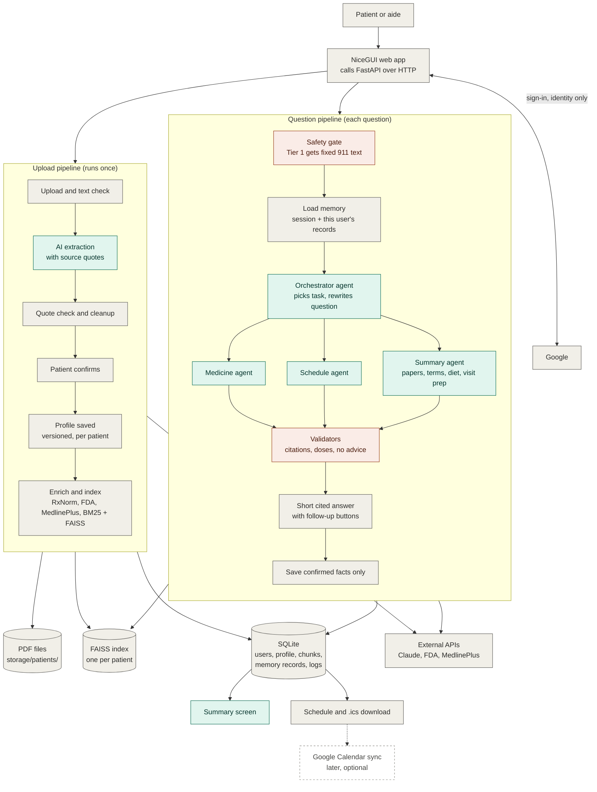

# AfterCare

A Python web app that helps adults (18+) and their caregivers understand their own hospital discharge papers during the first 30 days at home. It **explains** what the papers, official FDA drug labels, and MedlinePlus plain-language definitions say, with short cited answers. It never diagnoses or tells anyone to change a medicine.

Graduate course project (INFO 7375, Building AI Applications). **Synthetic data only. Not medical advice.**

## Status

Built so far: the foundation (configuration, database, file storage, health check) and Google sign-in with a phone-friendly login page, all tested. Document upload is next (see [`docs/roadmap.md`](docs/roadmap.md)).

## Run it

You need Python 3.12 (ADR-0019).

```bash
py -3.12 -m venv .venv                          # Windows; use python3.12 elsewhere
.venv\Scripts\Activate.ps1                      # Windows PowerShell; use source .venv/bin/activate elsewhere
pip install -r requirements.txt -r requirements-dev.txt
cp .env.example .env                            # then fill in your own values
pytest                                          # run the tests
uvicorn app.main:app --port 8000                # start the backend; try http://localhost:8000/health
python -m ui.main                               # in a second terminal: the web page at http://localhost:8080
```

Signing in needs your own Google test client in `.env` (steps in [`TEAM_SETUP.md`](TEAM_SETUP.md)). The page only listens on `127.0.0.1`; set `UI_HOST` to change that.

Never commit `.env`. Lint and format checks are `ruff check .` and `ruff format --check .`.

## Start here

| File | What it is |
|------|------------|
| [`TEAM_SETUP.md`](TEAM_SETUP.md) | Get your machine ready (about 15 minutes) |
| [`CLAUDE.md`](CLAUDE.md) | Scope, architecture, safety design, storage, coding rules (sections 1–19) |
| [`CONTRIBUTING.md`](CONTRIBUTING.md) | Branches, commits, pull requests, reviews, who owns what |
| [`docs/roadmap.md`](docs/roadmap.md) | Sprint plan, who does what, and the open design findings |
| [`docs/architecture.md`](docs/architecture.md) | The two pipelines in detail |
| [`docs/decisions/`](docs/decisions/README.md) | Every project decision, why it was made, and its history (ADRs) |

## Architecture at a glance



Red = fixed safety code. Green = uses AI. Gray = plain code or data. Dashed = planned later.

Agents decide *how* to answer; fixed code decides *whether* safety checks run. Diet and physiotherapy agents will plug in under the orchestrator later.

Input is the digital PDF for the paperwork and typed text for questions; photo and voice are not built for now.

Stack: Python 3.12, FastAPI, NiceGUI, Google sign-in, PyMuPDF, pdfplumber, Anthropic SDK (Claude), Pydantic, SQLite + SQLModel, rank_bm25, FAISS with a local embedding model, RxNorm, openFDA, MedlinePlus, icalendar, textstat, pytest, ruff.
