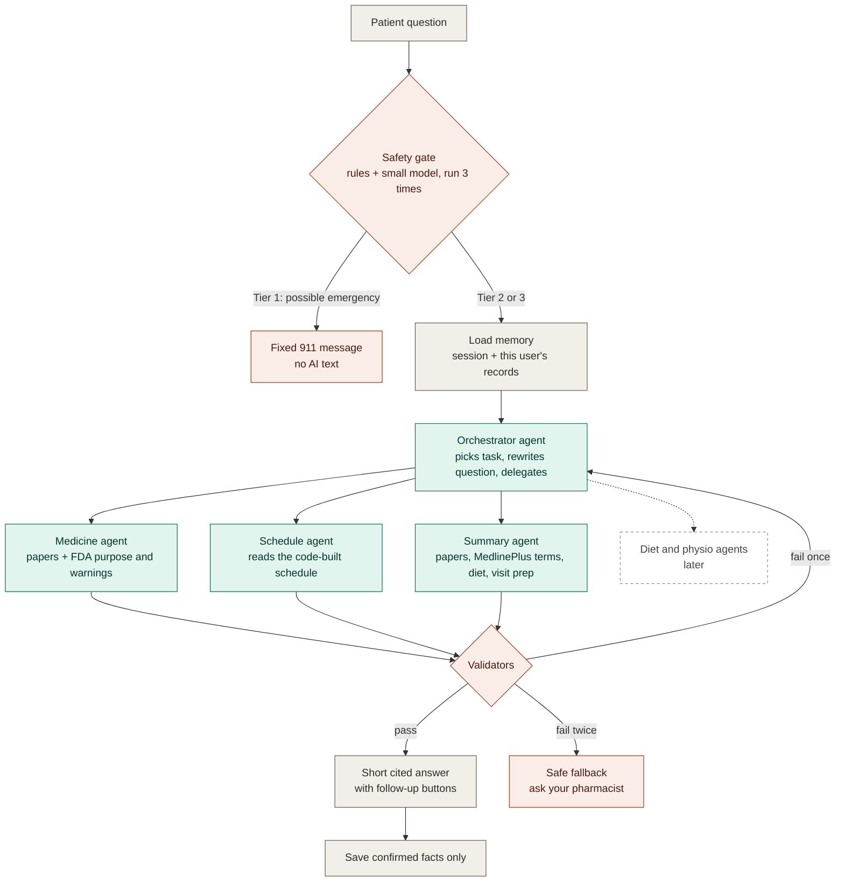

# Architecture

The overview diagram is in the [README](../README.md#architecture-at-a-glance). How this maps to the Assignment 3 deck (what is MVP and what is later) is in [assignment-3-mapping.md](assignment-3-mapping.md). This page goes one level deeper. Why each choice was made is in [`decisions/`](decisions/README.md); the rules are in [`CLAUDE.md`](../CLAUDE.md).

## The core rule

**Agents decide how to answer. Fixed code decides whether safety checks run.** No agent can skip, call, or change the safety gate or the validators, and no agent can write patient data (ADR-0004).

## Question pipeline

- **Tiers:** Tier 1 gets the fixed 911 text. Tier 2 answers lead with the care team name and phone number. Tier 3 gets a normal grounded answer. If the classifier fails, the default is Tier 2, never Tier 3 (ADR-0005).
- **Agent limits:** at most 6 tool calls per question, depth 1, a 30-second timeout, read-only tools, and every call logged. On any limit, the safe fallback is returned (ADR-0008).
- **Validators:** check every cited ID was retrieved, doses and names match the confirmed profile, no dose-change advice or diagnosis, short and plain wording, and the care team line on Tier 2. One regeneration is allowed, then the fallback.

## Upload pipeline

Fixed steps, no agents:

1. Upload and text check. Scanned PDFs with no text layer get a friendly rejection (ADR-0007).
2. AI extraction into a structured list, with a source quote for every item.
3. Code checks that each quote really appears in the document, then fixes abbreviations (BID, TID, PRN and similar).
4. The patient confirms, edits, or removes each item next to the original line. Nothing unconfirmed is ever used.
5. The profile is saved as a new version.
6. Enrichment and indexing: RxNorm names, FDA label purpose and warnings, MedlinePlus definitions for terms in the papers, then chunks indexed for hybrid search: BM25 plus a per-patient FAISS index (ADR-0027, ADR-0028, ADR-0023). The extracted text is also scanned for commands aimed at an AI (ADR-0031).

## Where AI is used

| Uses AI | Plain code |
|---|---|
| Reading the PDF into a structured list | Checking quotes against the document |
| The plain-language summary | The schedule and the `.ics` calendar file |
| The safety classifier (alongside keyword rules) | The safety gate's final decision and the 911 message |
| Answering questions | The validators |

## Trust and privacy boundaries

- **Sign-in:** Google, identity only. Every request needs a signed-in user, and the patient must belong to that user (ADR-0021).
- **Storage:** local disk and SQLite for development; nothing leaves the machine except calls to Claude, RxNorm, openFDA, and MedlinePlus. S3 only for the final demo (ADR-0013, ADR-0020).
- **Every query filters by `patient_id` first**, so one patient's question can never retrieve another patient's papers.
- **Synthetic data only.** No real patient data, keys, or secrets in the repository (ADR-0017).
