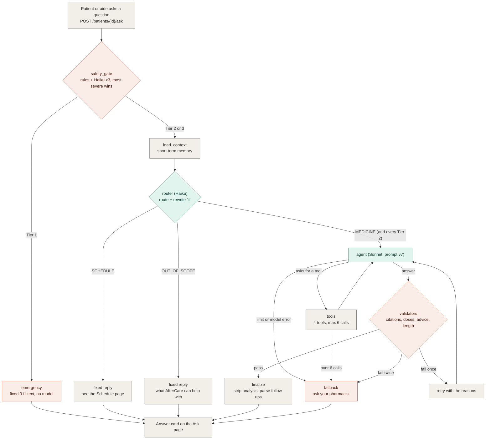

# The question workflow as built

This is the graph in `app/agents/question_graph.py`, step for step. Red = fixed safety code,
green = uses a model, gray = plain code.

## Step by step

| Step | What happens | Kind of decision |
|---|---|---|
| safety_gate | Keyword rules and the patient's own warning signs, plus a small model run 3 times; the most severe tier wins. Tier 1 stops here | Fixed code: whether to continue |
| load_context | Starts a clean run; the endpoint already loaded the last turns and the medicine in focus | Plain code |
| router | A small model picks one of three routes and rewrites the question using the recent turns | Model: where to go (a response or an action) |
| fixed replies | Schedule and out-of-scope questions get a code-written reply | Response, no agent |
| agent and tools | ReAct: the model reasons, asks for a tool, we run it and hand back the result, repeat | Model: act (call a tool) or respond |
| validators | Cited IDs were retrieved; doses, times and names match; no advice or diagnosis; short and plain; care-team line on Tier 2 | Fixed code: may the answer be shown |
| retry and fallback | One retry with the reasons; then a fixed safe message | Fixed code |

## Context flow

- **Prompt:** the confirmed profile written as text (`app/qa/profile_text.py`) fills `{patient_profile}`.
- **RAG:** the agent calls `search_patient_document`; the retriever filters by the patient in code.
- **Tools:** drug labels (openFDA) and names (RxNorm) come back as tool results; labels get `L#` IDs.
- **Memory:** short-term memory feeds the router; nothing is saved to long-term memory yet.

## Use cases it serves

| Use case | Path |
|---|---|
| Cited medicine, diet or follow-up question | gate -> router MEDICINE -> agent with tools -> validators |
| A symptom | gate Tier 1: fixed 911 text. Tier 2: agent, and the answer must lead with the care team |
| Schedule question | router SCHEDULE -> pointer to the Schedule page (the schedule is built by code) |
| Upload to summary | the separate upload graph (`app/agents/upload_graph.py`) |
