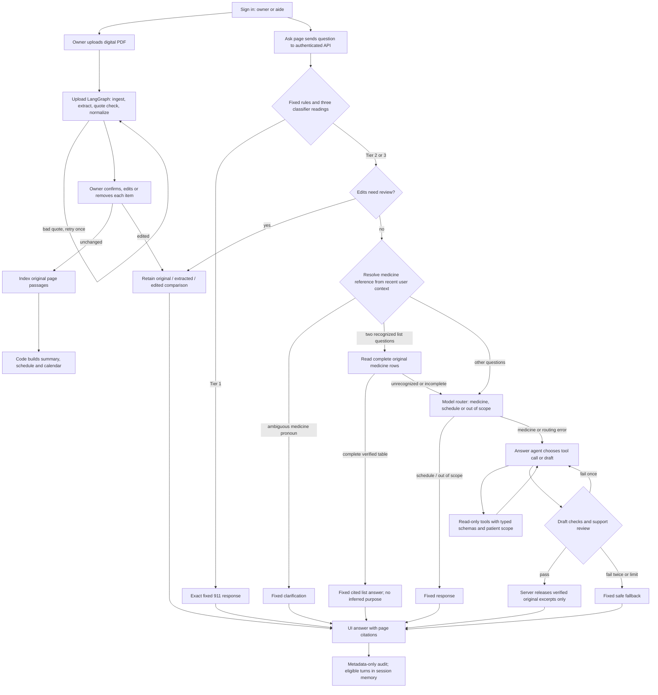

# Workflow implemented for Assignment 4

Verified locally on `vinayarekha`, 2026-11-21. These changes are not claimed to be merged into main.

## Execution and context

The safety gate is fixed code and precedes both direct lookups and the model agent. Any Tier 2
reply retains a care-team instruction. Neither an agent nor a tool can downgrade the gate.

The common questions “Which medicine is new?” and “What is each of my medicines for?” call
`read_original_medicine_entries` through the same typed ToolRegistry execution mechanism.
The tool reads the current patient's original DocumentPage records, keeps complete table entries,
and checks coverage against explicit status markers. An edited profile cannot supply evidence.
A purpose is quoted only when a positive, explicit purpose phrase is present in that entry;
otherwise the answer says it could not verify one. Partial or unknown layouts use the regular path.

Other document questions use a ReAct-style loop: the model chooses an allowed read-only tool,
code validates its arguments and executes it, and the next model turn receives its result.
The agent receives `get_confirmed_medicines` and `search_patient_document`; external label/name
services are not answer sources. `get_schedule` remains a separate registry utility.

| Component | Context passed | Authority |
|---|---|---|
| Prompt | Confirmed profile, original question, typed tool descriptions | Instructions, not clinical evidence |
| RAG | Current-patient and current-document original passages, with D IDs and pages | Original paper text |
| Session memory | Recent user questions and code-resolved medicine identity | Reference resolution only |
| Tools | Server-bound patient ID, validated arguments; typed results | Read-only execution |
| Final response | Original excerpts or code templates tied to original rows | Model interpretations cannot be released |
| Audit | IDs, tiers, tool names, counts and checks | No patient question/answer text |

Limits remain six agent tool calls, one answer retry and a 30-second check between steps.
An in-flight provider call is not forcibly interrupted. See `challenges-and-limits.md`.
