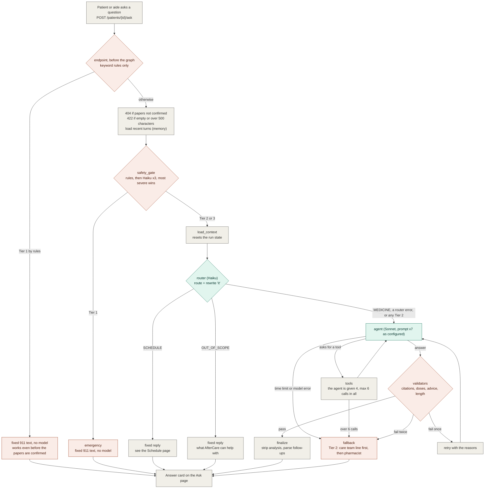

# The question workflow as built

This is the path of one question through `POST /patients/{id}/ask` (`app/qa/routes.py:146`) and the
graph in `app/agents/question_graph.py`, step for step, as on `main`. Red = fixed safety code,
green = uses a model, gray = plain code.

## Step by step

| Step | What happens | Kind of decision |
|---|---|---|
| endpoint checks | The keyword rules run first on the full text; Tier 1 returns the fixed 911 text before anything else (`routes.py:161-175`). Then 404 if the papers are not confirmed (176-177) and 422 for an empty question or one over 500 characters (178-185). Recent turns are loaded from session memory (204) | Fixed code: whether to continue |
| safety_gate | Keyword rules and the patient's own warning signs, plus a small model run 3 times in parallel; the most severe tier wins. A Tier 1 from the rules returns without calling the model (`gate.py:45-53`). A failed or unreadable model run counts as Tier 2 (`classifier.py:87-89`) | Fixed code: whether to continue |
| load_context | Starts a clean run (`question_graph.py:233-242`). It does not load memory: the endpoint already did | Plain code |
| router | A small model picks one of three routes and rewrites the question using the last 4 turns (`RECENT_TURNS`, line 53). If the model call fails the question goes to the agent (255-256); a Tier 2 question is always sent to the agent (259-260); a rewrite that is empty, over 500 characters or much longer than the original is replaced by the patient's own words (262-265) | Model: where to go (a response or an action) |
| fixed replies | Schedule and out-of-scope questions get a code-written reply (`SCHEDULE_REPLY`, `OUT_OF_SCOPE_REPLY`, lines 60-66) | Response, no agent |
| agent and tools | ReAct: the model reasons, asks for a tool, we run it and hand back the result, repeat. The agent is given 4 of the registry's 5 tools (`get_schedule` is not given to it; `question_graph.py:46-51`, `routes.py:195`). More than 6 calls in total ends in the fallback (329-330) | Model: act (call a tool) or respond |
| validators | Cited IDs were retrieved; doses, times and names match; no advice or diagnosis; short and plain; care-team line on Tier 2 (`app/qa/validators.py`, `Check` list lines 26-38). If the model's whole reply is the fixed 911 text, the answer is treated as an emergency (`question_graph.py:358-359, 400-402`) | Fixed code: may the answer be shown |
| retry and fallback | One retry with the reasons (`MAX_ATTEMPTS = 2`, line 52); then a fixed safe message. A Tier 2 fallback leads with the care team line (164-172). An unexpected error inside the graph also ends in the fallback (`run_question`, 506-523) | Fixed code |
| after the graph | An answered, redirected or out-of-scope turn is saved to short-term memory; an emergency or a fallback is not (`routes.py:208-213`). A log row with IDs, counts and timings is written (`_log_row`, 105-122) | Plain code |

## Limits in the code

| Limit | Value | Where |
|---|---|---|
| Tool calls per question | 6, counted across retries | `config.py:47`, `question_graph.py:329` |
| Agent time limit | 30 seconds, checked only before each model call, never inside one | `config.py:48`, `question_graph.py:294` |
| Classifier wait | 10 seconds for the 3 runs together | `config.py:55`, `classifier.py:77` |
| Classifier reply limit | 200 tokens on `main` (`classifier.py:20`). A larger limit and a stricter reading of the reply are in a pending PR (#25), not on `main` | |
| One model call | 60 seconds, 2 SDK retries | `config.py:43`, `llm.py:81` |
| Question length | 500 characters | see `challenges-and-limits.md` |

## Context flow

- **Prompt:** the confirmed profile written as text (`app/qa/profile_text.py`) fills `{patient_profile}`.
- **RAG:** the agent calls `search_patient_document`; the retriever filters by the patient in code.
- **Tools:** drug labels (openFDA) and names (RxNorm) come back as tool results; labels get `L#` IDs.
- **Memory:** session memory keeps the last 10 turns and the medicine in focus (`config.py:53`, `app/memory/session.py`), but only the router reads the last 4 of them; the agent sees the router's rewritten question, not the history. Nothing is saved to long-term memory (not built).

## Use cases it serves

| Use case | Path |
|---|---|
| Cited medicine question | gate -> router MEDICINE -> agent with tools -> validators |
| Diet or follow-up question | The same path; there is no diet-specific code path, tool or eval case (see `use-case-map.md`) |
| A symptom | gate Tier 1: fixed 911 text. Tier 2: agent, and the answer must lead with the care team |
| Schedule question | router SCHEDULE -> pointer to the Schedule page (the schedule is built by code) |
| Upload to summary | the separate upload graph (`app/agents/upload_graph.py`: ingest, extract, check_quotes, normalize) |

## Corrections made to the earlier version of this file

1. The flowchart started at the gate. The endpoint runs the keyword rules first, then the 404 and 422 checks (`routes.py:161-185`), so I added that step and its separate 911 exit.
2. `load_context` was labelled "short-term memory". It only resets state (`question_graph.py:233-242`); the endpoint loads memory (`routes.py:204`) and saves it afterwards (208-213). The step table was right; the flowchart label was not.
3. The gate's Tier 1 exit does not call the model; this is now said.
4. The router's behaviour on error, on Tier 2 and on a bad rewrite was missing.
5. "4 tools" now says the registry has 5 and the agent is given 4.
6. The fallback now notes that Tier 2 leads with the care team line.
7. The validators step now notes the model's own 911 text is treated as an emergency.
8. "Short-term memory feeds the router" now says the router reads 4 of the 10 stored turns and the agent does not see the history.
9. The use-case table listed "diet" as a cited question. It works only by the general path; I said so and added no claim of a dedicated path.
10. Added the limits table, with the classifier reply limit as it is on `main` and the fix marked pending PR #25.
